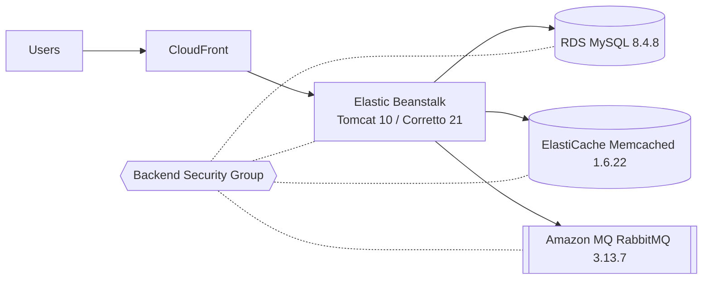
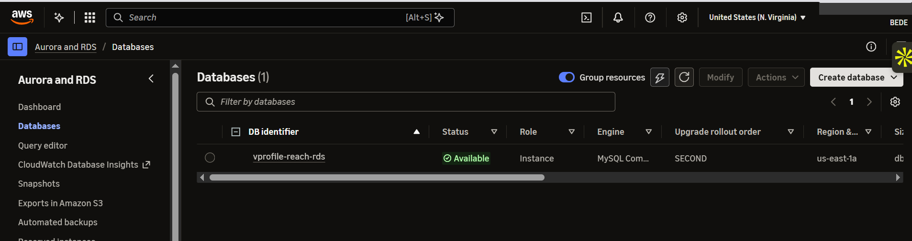
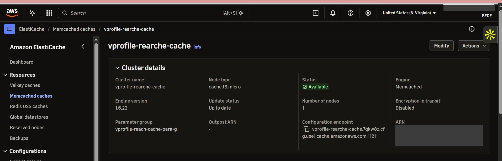
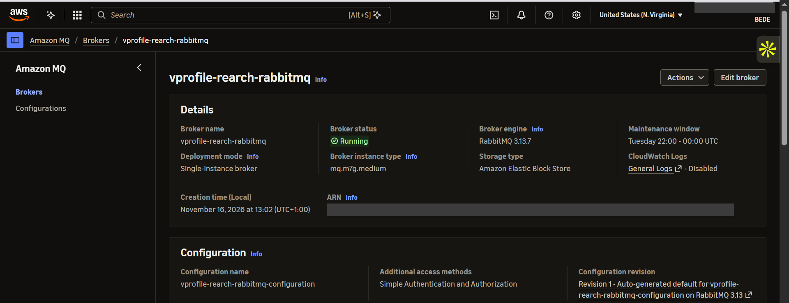
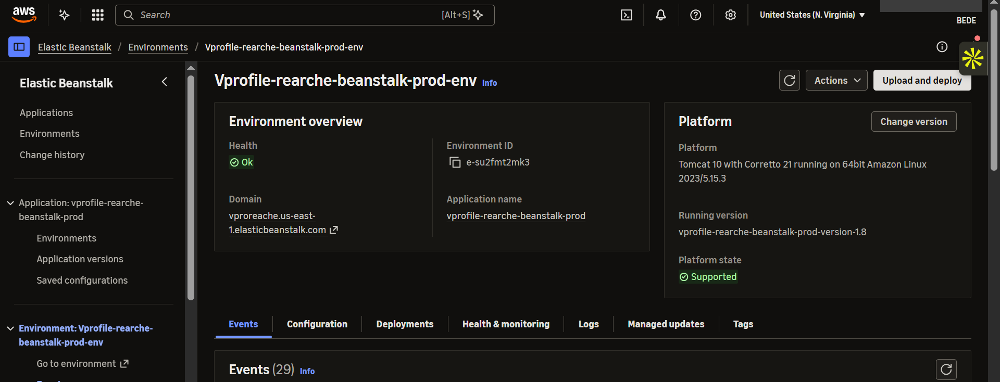
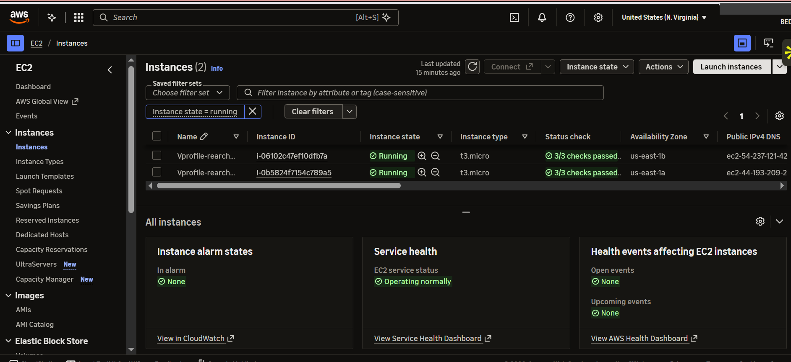
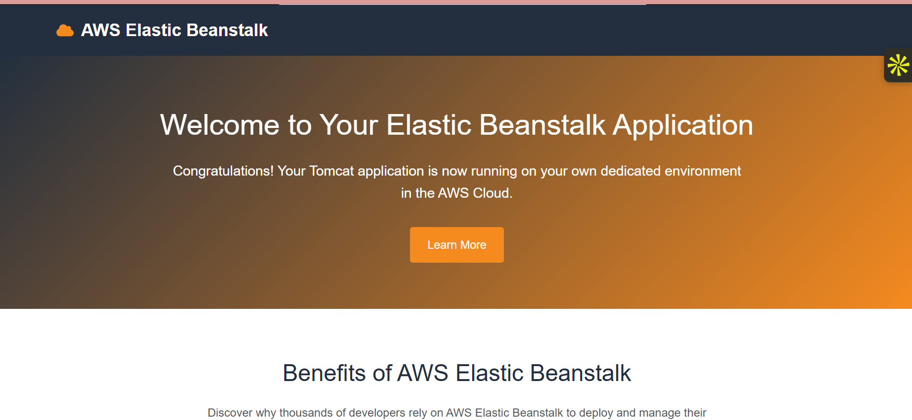
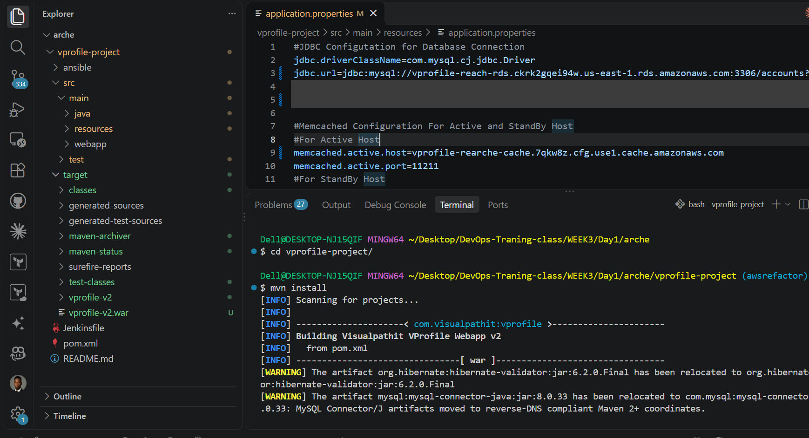
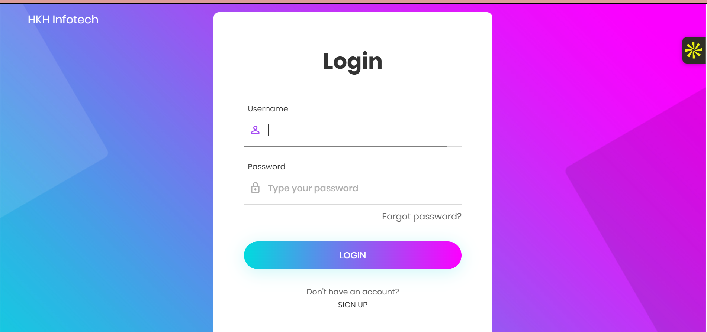
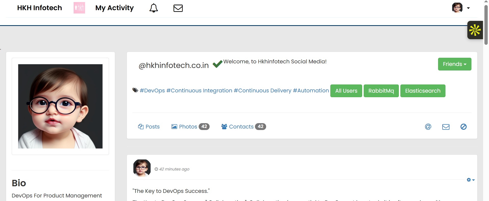

# vProfile Re-architecture on AWS (Refactor to Managed Services)

Re-architecting the vProfile Java web application from self-managed EC2 servers to AWS managed services: **Elastic Beanstalk, RDS, ElastiCache, Amazon MQ and CloudFront**.

> Application source: [hkhcoder/vprofile-project](https://github.com/hkhcoder/vprofile-project) (branch: `awsrefactor`)

## Architecture



## Lift-and-shift vs. re-architecture

| Component | Lift-and-shift (earlier project) | Re-architecture (this project) |
|---|---|---|
| App server | EC2 running Tomcat | Elastic Beanstalk (Tomcat 10, Corretto 21) |
| Database | MySQL on EC2 | Amazon RDS MySQL |
| Cache | Memcached on EC2 | Amazon ElastiCache (Memcached) |
| Messaging | RabbitMQ on EC2 | Amazon MQ (RabbitMQ) |
| Delivery | ALB / Route 53 | Beanstalk + CloudFront |

## Services and configuration

| Service | Configuration |
|---|---|
| Security group | One backend SG shared by all tiers, allowing traffic from itself on the service ports (MySQL 3306, Memcached 11211, RabbitMQ 5671) |
| RDS MySQL | Engine 8.4.8, dev/test single-AZ, 20 GB storage, not publicly accessible, custom parameter group and subnet group |
| ElastiCache | Memcached 1.6.22, node-based cluster, custom parameter group and subnet group, default VPC |
| Amazon MQ | RabbitMQ 3.13.7, single-instance, `mq.m7g.medium`, private access |
| Elastic Beanstalk | Tomcat 10 with Corretto 21 on Amazon Linux 2023, custom IAM roles |
| CloudFront | Distribution in front of the Beanstalk environment |

## Implementation steps

1. **Foundation**: create the backend security group and an EC2 key pair (`.pem`).
2. **RDS**: create the MySQL instance with a parameter group and subnet group; attach the backend SG; keep it private.
3. **ElastiCache**: create the Memcached cluster with a parameter group and subnet group; attach the backend SG.
4. **Amazon MQ**: create the RabbitMQ broker (private access); attach the backend SG.
5. **Initialize the database**: because RDS is private, launch a temporary Ubuntu EC2 in the same VPC and:
   ```bash
   sudo apt update && sudo apt install mysql-client git -y
   git clone https://github.com/hkhcoder/vprofile-project.git
   cd vprofile-project && git checkout awsrefactor
   mysql -h <RDS_ENDPOINT> -u <DB_USER> -p <DB_NAME> < src/main/resources/db_backup.sql
   ```
   Verify by logging in and listing tables, then **terminate the temporary instance**.
6. **Elastic Beanstalk**: create the IAM service role and EC2 instance profile, then create a Tomcat 10 / Corretto 21 environment with the required configuration. Confirm health is **Ok**.
7. **Build and deploy**: update `application.properties` with the RDS, Memcached and RabbitMQ endpoints, then:
   ```bash
   mvn install
   ```
   Upload the generated WAR (`target/vprofile-v2.war`) to Beanstalk via **Upload and deploy**.
8. **Validate**: open the environment URL, log in, and test database, cache and messaging features.
9. **CloudFront**: create a distribution with the Beanstalk URL as the origin for faster delivery.

## Configuration (secrets masked)

```properties
jdbc.url=jdbc:mysql://<RDS_ENDPOINT>:3306/accounts
jdbc.username=<DB_USER>
jdbc.password=<DB_PASSWORD>

memcached.active.host=<MEMCACHED_CONFIG_ENDPOINT>
memcached.active.port=11211

rabbitmq.address=<MQ_ENDPOINT>
rabbitmq.port=5671
rabbitmq.username=<MQ_USER>
rabbitmq.password=<MQ_PASSWORD>
```

> Never commit real credentials. Use Beanstalk environment properties or a secrets manager.

## Challenges and lessons learned

- **Understanding the overall workflow** took about 5 days, since six services depend on each other (security groups, IAM, networking, data, messaging, deployment).
- **Elastic Beanstalk abstraction**: learning how it provisions EC2, load balancing and scaling, and how the service role and instance profile differ. Solved by working through the official documentation and building step by step.
- **Amazon MQ subnet error**: single-instance deployment accepts only one subnet; selecting all default subnets caused a validation error. Fixed by selecting a single subnet.
- **Private database access**: RDS was not public, so schema initialization required a temporary EC2 inside the VPC.

## Screenshots

> Account IDs and credentials are masked.

### 1. Backend services

**RDS MySQL** is available:



**ElastiCache Memcached** cluster is available (Memcached 1.6.22, cache.t3.micro):



**Amazon MQ RabbitMQ** broker is running (single-instance, `mq.m7g.medium`):



### 2. Application platform

**Elastic Beanstalk environment** healthy (Tomcat 10 with Corretto 21):



**EC2 instances** launched by Beanstalk, running with 3/3 status checks passed:



**Beanstalk default page**, confirming the Tomcat environment was up before deploying the app:



### 3. Build and deploy

Updating `application.properties` (credentials masked) and building the WAR with `mvn install` on the `awsrefactor` branch:



### 4. Final result

**vProfile login page** served from the Beanstalk environment:



**Application dashboard**, showing the app working end to end:



## Cleanup (to avoid charges)

Terminate the Beanstalk environment, delete the CloudFront distribution, Amazon MQ broker, ElastiCache cluster and RDS instance (take a final snapshot if needed).

## Tools

AWS (Elastic Beanstalk, RDS, ElastiCache, Amazon MQ, CloudFront, IAM, VPC/EC2), Maven, Git, VS Code, MySQL, Tomcat 10, Java (Corretto 21).
